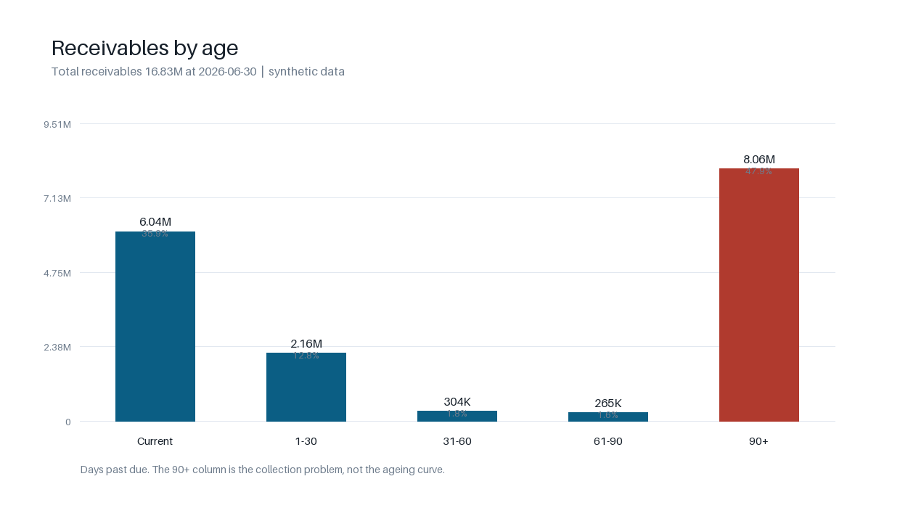
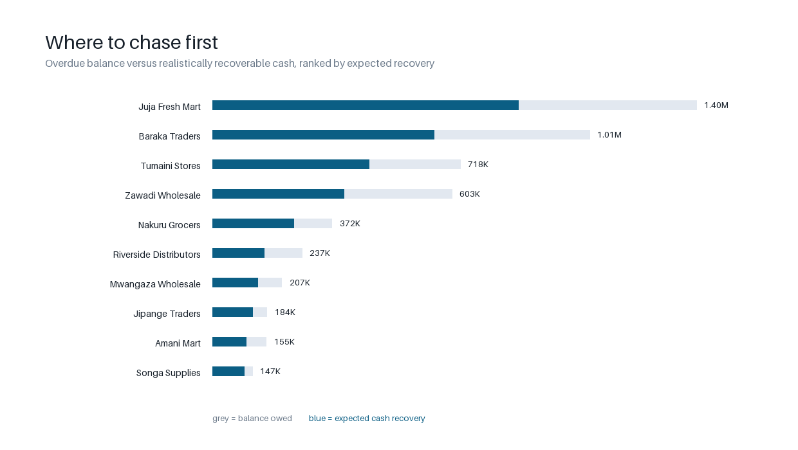
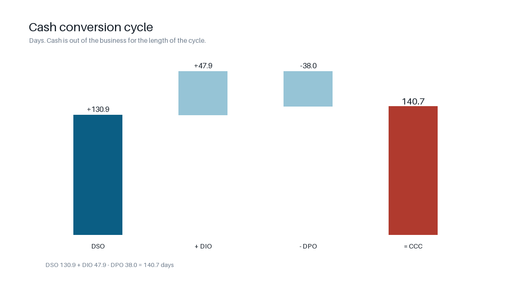

# Why cash is stuck: a wholesaler receivables and cash-conversion diagnostic

**A worked case study, not a chart pack — and the data is synthetic, disclosed
here on the first line.** A wholesale distributor is carrying **KES 16.83M** in
receivables, **64.1% of it past due**, and **47.9% of it more than 90 days
overdue**. I traced where the money sits, who owes it, what is actually
collectible, and which credit terms let it happen — then ranked the collections
work by the cash it would recover.

**Patrick Gichuki** — Sales & Financial Performance Analyst
[GitHub](https://github.com/BIAnalyst-Patrick) · [LinkedIn](https://www.linkedin.com/in/patrick-gichuki-the-bi-analyst) · [patrickgichuki2@gmail.com](mailto:patrickgichuki2@gmail.com)

| | |
|---|---|
| **The question** | Revenue is fine but cash is not. Which accounts are holding it, what is genuinely recoverable, and what do we change so it stops? |
| **The decision it feeds** | This month's collections list, the accounts to put on cash terms, and the case for a stop-supply rule — ranked by cash, not by age. |
| **The answer** | KES 6.73M of the 10.79M overdue is realistically collectible, and **three accounts carry 47% of it**. The 83.9-day gap between DSO and best-possible DSO is a collection failure, not a terms problem. |
| **Stack** | Python (standard library only for the analysis), SQL-style ledger modelling, Pillow for charts |
| **Scale** | 60 customers · ~1,900 invoices · 18 months · 15/15 independent checks |
| **Data** | **Simulated** from a seeded, documented mechanism — fingerprint `b486c28acb5e74af…` |



*The 90+ column is the collection problem, not the shape of a normal ageing curve.*

---

## 1. The decision this supports

> **Which accounts get chased this week, which get cash terms, and what is the cash worth?**

The analysis is only useful to the extent it answers that. It does, in section 4
and in `docs/02_recommendations.md`, with an owner and a review date on every action.

## 2. What happened — the headline

| Measure | Value | Read |
|---|--:|---|
| Credit sales, last 90 days | KES 11.57M | Trading is healthy; this is not a demand problem |
| Total receivables | KES 16.83M | 131 days of sales sitting in customers' hands |
| Overdue | KES 10.79M | **64.1%** of the ledger is past its due date |
| In the 90+ bucket | KES 8.06M | **47.9%** of receivables, and 74.7% of all overdue |
| DSO | **130.87 days** | Against a best possible of **46.98** |
| Collection effectiveness | **49.1%** | Collecting less than half of what was collectible |
| Expected credit loss | KES 3.78M | 22.4% of receivables, from the age profile |
| Cash recoverable now | **KES 6.73M** | 62.4% of the overdue balance |

## 3. Where the money actually sits

| Bucket | Balance | Share of receivables |
|---|--:|--:|
| Current | 6,041,341 | 35.9% |
| 1-30 days | 2,161,615 | 12.8% |
| 31-60 days | 304,293 | 1.8% |
| 61-90 days | 265,369 | 1.6% |
| **90+ days** | **8,056,070** | **47.9%** |

The shape is the finding. The middle of the ageing curve is almost empty while
the end of it holds half the ledger: balances do not drift late, they fall off a
cliff. Every one of the five largest overdue accounts received four to six
invoices in the last 90 days, the most recent in June 2026 — they are still
being supplied more than a year after their oldest invoice fell due.

That is not an ageing curve. That is unsecured lending.

## 4. Who to chase first



Ranked by **expected cash recovery** — balance owed, haircut by age and adjusted
by payment history — not by how much is owed.

| # | Account | Overdue | Expected recovery | Likelihood | Oldest |
|--:|---|--:|--:|--:|--:|
| 1 | Juja Fresh Mart | 2,215,162 | **1,398,527** | 63% | 434 days |
| 2 | Baraka Traders | 1,725,877 | **1,014,867** | 59% | 466 days |
| 3 | Tumaini Stores | 1,134,558 | **717,876** | 63% | 408 days |
| 4 | Zawadi Wholesale | 1,096,210 | 602,915 | 55% | 422 days |
| 5 | Nakuru Grocers | 546,292 | 372,220 | 68% | 415 days |

**The top three accounts are 47.1% of the overdue balance and 46.5% of the
recoverable cash.** The top five are 62.3% and 61.0%. A collections function
that works this list in order recovers most of the available cash with a tenth
of the effort. The full ranked list of 52 accounts is in
[`outputs/tables/chase_list.csv`](outputs/tables/chase_list.csv).

## 5. Which credit terms to change

17 accounts qualify: nine move from 45 or 60 days to 30, eight move to cash on
delivery. Full list with the days-late that triggered each in
[`outputs/tables/terms_changes.csv`](outputs/tables/terms_changes.csv).

This is the **smaller** lever, and worth being honest about: shifting every
60-day account to 30 days moves at most 30 days of DSO. The gap between DSO and
best-possible DSO is **83.9 days**. The money is in collection, not in the
paperwork — but the terms are what let an account 434 days overdue stay on
60-day credit.

## 6. What the cash is worth



| Figure | Value |
|---|--:|
| Cash past its due date | 10,787,346 |
| Realistically recoverable now | **6,731,146** |
| Recoverable from the top five | 4,106,405 |
| Provision implied by the age profile | 3,776,088 |

The cash conversion cycle is **140.7 days** — DSO 130.9, plus inventory 47.9,
minus payables 38.0. Every day of DSO is worth KES 128,593 of sales; the 83.9-day
gap to best-possible DSO is the size of the hole, and it is the same cash as the
overdue balance seen from a different angle. They are not two opportunities.

## 7. Facts, hypotheses, and the edge of what this proves

The distinction matters more than the numbers, so it is explicit:

| Statement | Tier |
|---|---|
| Receivables are 16.83M, 64.1% overdue, 47.9% in 90+ | **Fact** (computed from the ledger) |
| Three accounts carry 47.1% of the overdue balance | **Fact** |
| The top five accounts still received invoices last quarter | **Fact** |
| KES 6.73M is recoverable | **Estimate** — the recovery haircuts are a rule of thumb, not a fitted model |
| The ECL provision of 3.78M | **Assumption** — matrix rates 0.5/2/8/20/45%, in the IFRS 9 shape but not calibrated to this book |
| Accounts "switch off" rather than drift | **Hypothesis** — consistent with the empty middle buckets, not proven by them |
| A stop-supply rule would have capped the 90+ balance | **Hypothesis** — arithmetic says yes, no counterfactual was run |

**Declared limits** (on the conclusions, not buried in a footnote):

- **The data is simulated.** Every figure here is synthetic, generated from the
  mechanism in [`docs/01_method.md`](docs/01_method.md). Nothing in this report
  is a claim about a real company's receivables.
- **Credit notes, taxes, multi-currency and write-offs are not modelled.** Each
  would change the numbers; none is silently approximated.
- **DIO and DPO come from monthly snapshots**, not stock counts or a payables
  ledger, so the CCC's inventory and payables legs are indicative.
- **Recovery likelihood is a heuristic**, deliberately transparent: age haircut ×
  grade factor, capped at the balance owed. A fitted model would beat it; this
  one can be argued with line by line.
- **Point-in-time, not a trend.** One reporting date, no seasonality, no
  post-period receipts.

## 8. Reproduce it

No installation. The analysis is standard library; only the charts need Pillow.

```bash
git clone https://github.com/BIAnalyst-Patrick/receivables-ageing-cash-conversion
cd receivables-ageing-cash-conversion

make test    # 50 tests, including a drift guard on the published answer key
make run     # regenerates the ledger, tables, answer key and charts
```

The seeded generator means the same seed always produces the same ledger; the
fingerprint in [`outputs/answer_key.json`](outputs/answer_key.json) identifies it.
[`outputs/validation_report.md`](outputs/validation_report.md) lists **15/15**
checks, each comparing a derived figure against an independent identity — buckets
against total receivables, CCC against its own components, the chase list against
its own sort order — rather than against numbers copied into a file.

## What this project demonstrates

1. **A governing question, not a data dump.** One decision, and every table is
   subordinate to it.
2. **Receivables arithmetic an accountant would sign** — ageing, DSO,
   best-possible DSO, collection effectiveness, a CCC with real inventory and
   payables legs, and an IFRS 9-shaped provision.
3. **Measures computed by tested code.** Not a spreadsheet screenshot: 50 tests,
   including edge cases (due-today, one-day-late, part-payments, no-history
   customers, zero-sales guards).
4. **A ranking that says what to do on Monday**, with an owner and a review date
   attached to each action.

---

**Analyst:** Patrick Gichuki
**GitHub:** [BIAnalyst-Patrick](https://github.com/BIAnalyst-Patrick)
**LinkedIn:** [patrick-gichuki-the-bi-analyst](https://www.linkedin.com/in/patrick-gichuki-the-bi-analyst)
